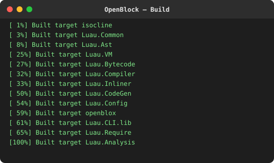
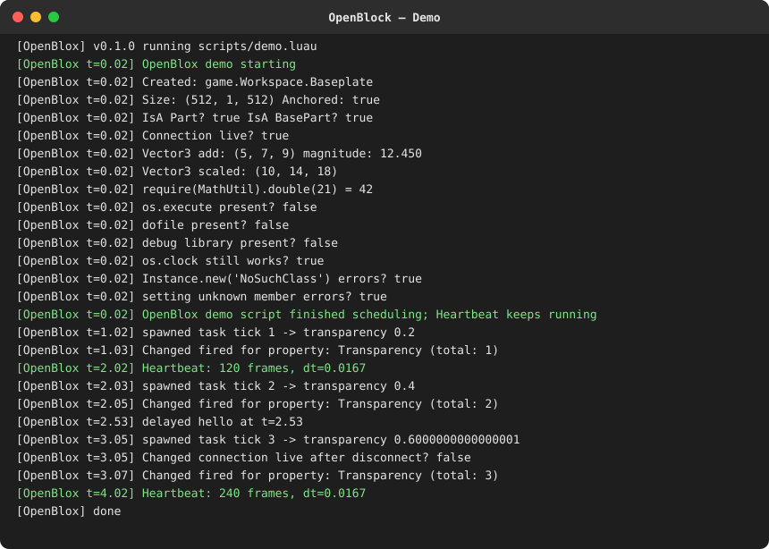
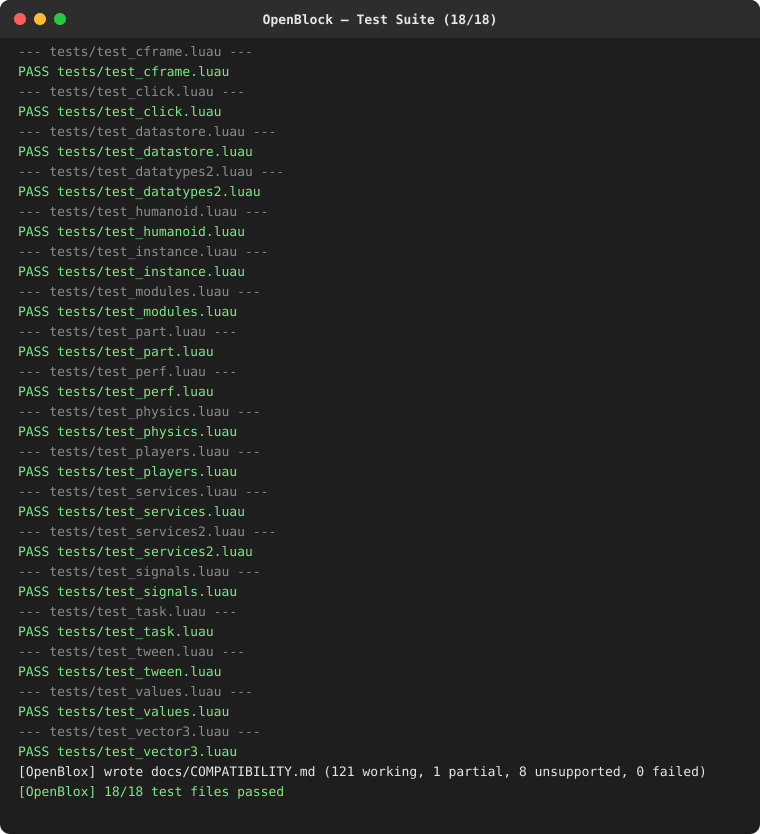
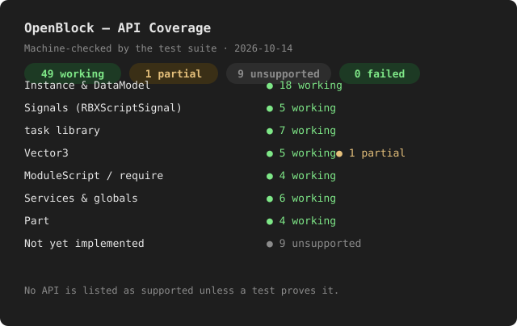

# OpenBlock

> **Working title.** OpenBlock is an independent, open-source voxel game
> engine and platform — build, script, and play block-based 3D experiences.
> Strictly a clean-room implementation; not affiliated with, endorsed by,
> sponsored by, or authorized by Roblox Corporation. "Roblox" is a trademark
> of Roblox Corporation.

OpenBlock is a from-scratch game engine: a real Luau script runtime, a
reflection-driven `Instance`/`DataModel` core, and modular physics,
rendering, networking, audio, and platform services.

**Principles:** clean-room implementation — public documentation,
MIT-licensed Luau, and permissively licensed dependencies only.
See `docs/ARCHITECTURE.md` §1–2.

## Quick start (v0.1 prototype, headless)

Requirements: CMake 3.16+, a C++17 compiler, git. Luau is vendored under
`third_party/luau` (MIT) — no downloads needed.

```sh
cmake -S . -B build -DCMAKE_BUILD_TYPE=Release
cmake --build build --parallel
./build/openblox scripts/demo.luau
./build/openblox --tests tests   # runs the engine test suite
```

The test run regenerates the API coverage report
(`docs/COMPATIBILITY.md`) — the honest, machine-checked record of which
scripting APIs work, partially work, or are unsupported. **No API is listed
as supported unless a test proves it.**

## Screenshots






## Layout

```
openblox/
  docs/          ARCHITECTURE.md, ROADMAP.md, COMPATIBILITY.md (generated)
  src/           C++ engine: luau-runtime, core-datamodel, datatypes,
                 scripting, and module interfaces (physics/rendering/…)
  scripts/       demo game scripts
  tests/         engine test suite (Luau)
  third_party/   vendored Luau (MIT); never proprietary code
```

## Docs

- [Architecture](docs/ARCHITECTURE.md) — module map, design decisions, v0.1
  scope, biggest technical challenges
- [Roadmap](docs/ROADMAP.md) — phased plan with test-backed done-criteria
- [API coverage](docs/COMPATIBILITY.md) — generated by the test suite

## Current status

Phase 1 (v0.1): headless core — real Luau VM, `Instance`/`DataModel`,
datatypes, signals, `task` scheduler, script contexts, demo + tests.
Rendering, physics, networking, and audio are architected module interfaces;
backends land in v0.3–v0.5 per the roadmap.
